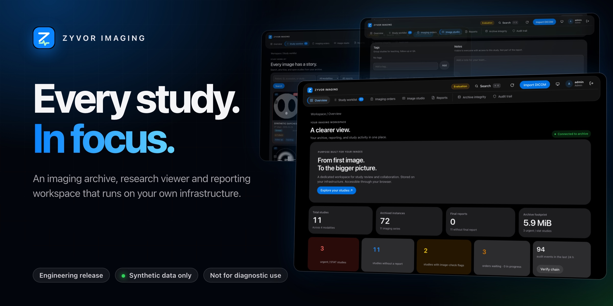
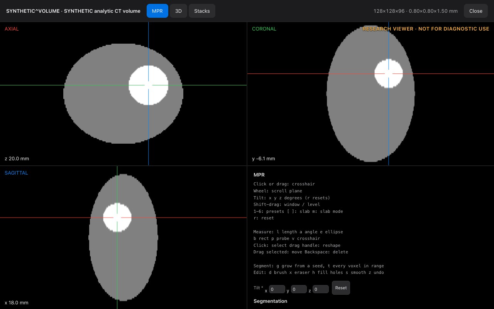
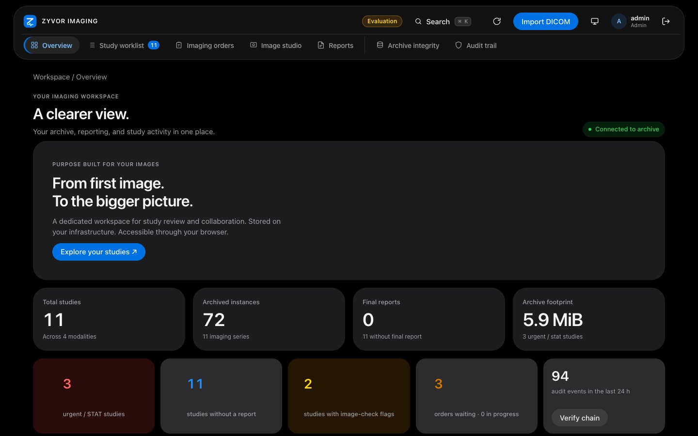
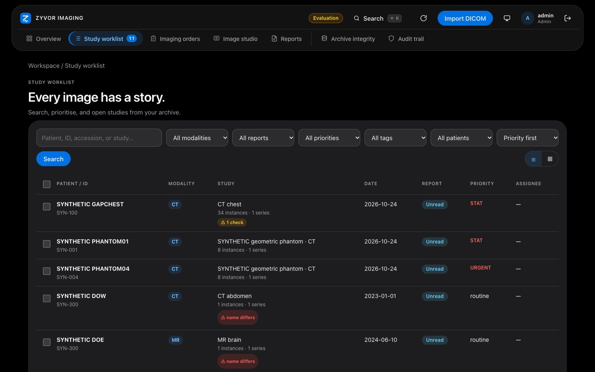
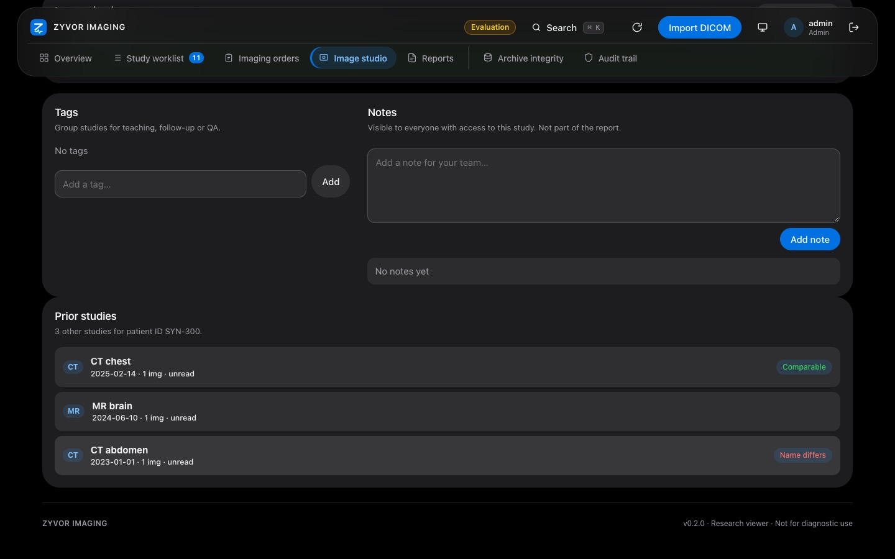
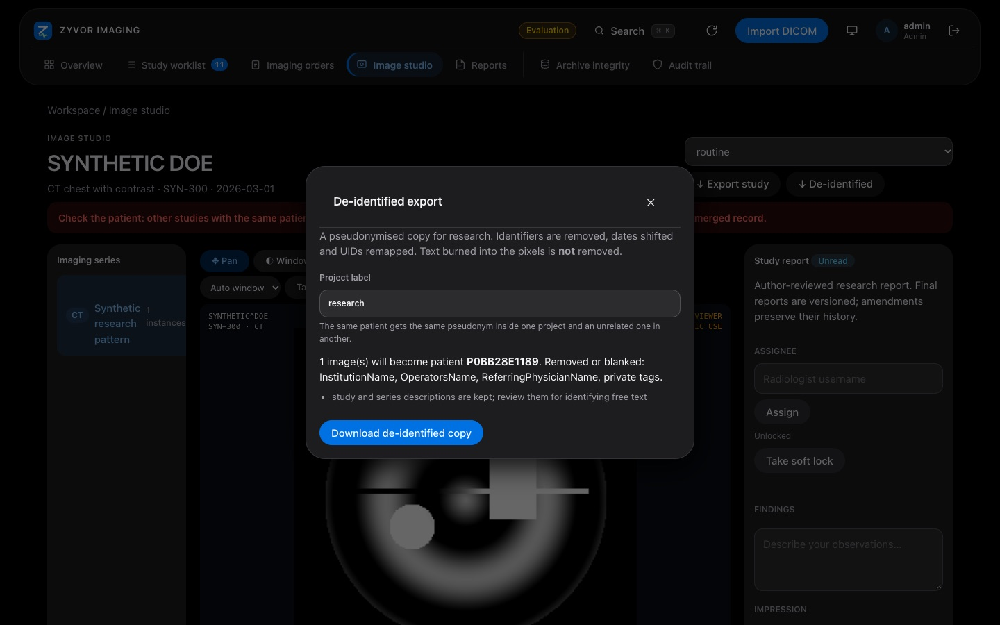
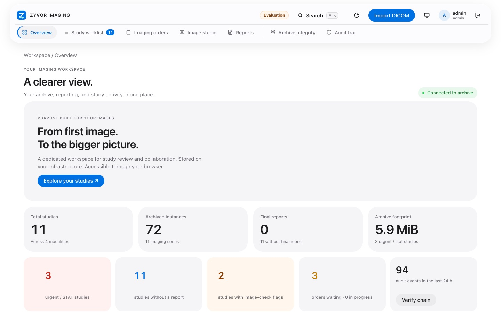
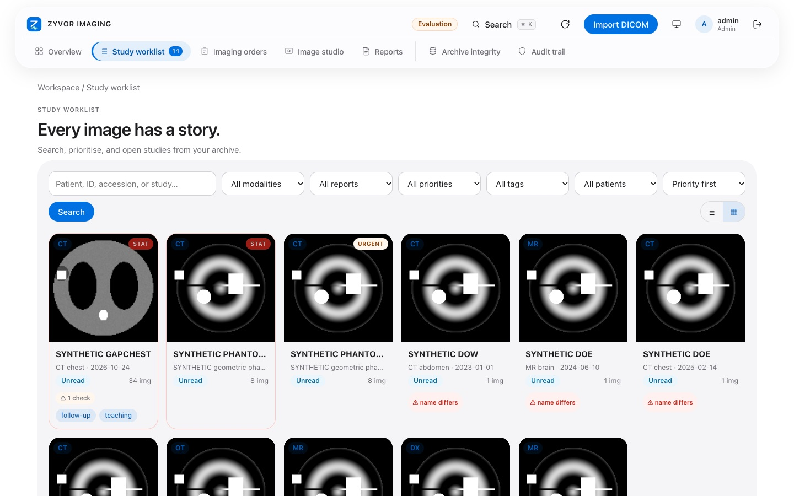
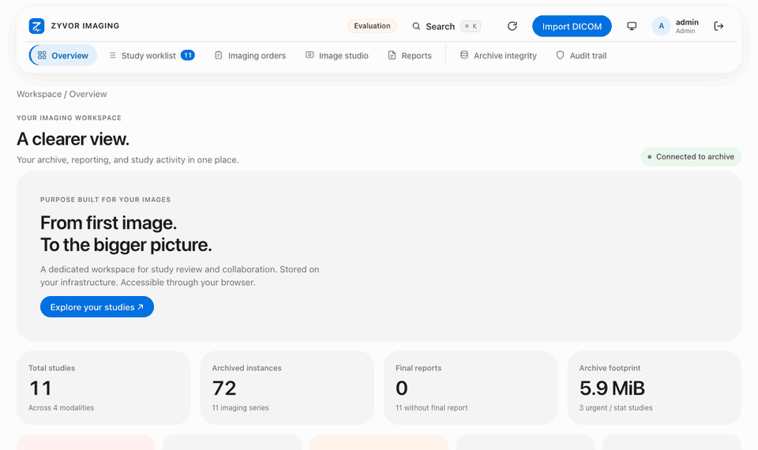

# Zyvor Imaging

### Every study. In focus.

**A medical imaging archive, research viewer and reporting workspace that runs on your own infrastructure.**

    

[**Try it in 2 minutes**](#try-it) · [**See it**](#see-it) · [**What you get**](#what-you-get) · [**Docs**](docs/README.md) · [**Releases**](https://github.com/zyvorai/zyvor-imaging-site/releases) · [**Ask for a demo**](mailto:sales@zyvor.dev?subject=Zyvor%20Imaging%20demo%20access)

> [!IMPORTANT]
> **Zyvor Imaging is an engineering / evaluation release.** It is built and tested with **synthetic data only**, it is a **research viewer, not for diagnostic use**, and it carries **no clinical validation or regulatory certification**. Please do not load real patient images into an evaluation. Read [Intended use and limits](docs/INTENDED-USE.md).

Archive, review and report on your imaging studies. You do not need to be technical to try it: open a link, or drag one app into Applications, and look at made-up patients.

This repository is the **public home of the Zyvor Imaging website and its evaluation releases**. There is no application source here; the product repository is private.

---

## Try it

Pick the way that suits you. Every option uses **synthetic (made-up) patients**, never real ones.

| | Path | Time | What you do |
|---|---|---|---|
| **1** | **Open a demo link** | about 2 min · nothing to install | [Email us](mailto:sales@zyvor.dev?subject=Zyvor%20Imaging%20demo%20access). We send a web link, a username and a password. Open it in Chrome, Safari or Edge. |
| **2** | **Mac app** | about 5 min | Download **`Zyvor-Imaging-*.dmg`** from the [latest release](https://github.com/zyvorai/zyvor-imaging-site/releases/latest) (not "Source code"), drag it into **Applications**, open it, paste the web address from our email and sign in. |
| **3** | **Run it on your own PC** | about 15 min the first time | Install [Docker Desktop](https://www.docker.com/products/docker-desktop/) once, download the **binary zip**, unzip it and double-click the installer for your computer. The login is in `DEMO-LOGIN.txt`. |

| **4** | **Live demo in one command** | about 2 min once Docker Desktop is running | On the [website's live demo section](https://zyvorai.github.io/zyvor-imaging-site/#live) the page writes one command and a fresh password for you, in your browser. Paste it into a terminal, open `http://127.0.0.1:8080` and sign in. Made-up studies only, including the phantom the viewer uses. |

Step by step, with the 10-minute test checklist: **[Getting started](docs/GETTING-STARTED.md)** · Stuck? **[Troubleshooting](docs/TROUBLESHOOTING.md)**

---

## The advanced research viewer

New in 0.4.0: linked MPR planes you can tilt, 3D volume rendering with a clip box, several series side by side, and saved measurements and segments, written for this product. A thirty-second recording of the real app on a made-up phantom is on the [website](https://zyvorai.github.io/zyvor-imaging-site/#live).

Research use only; not validated for diagnosis; no comparison with other viewers has been made. What was and was not checked: [The advanced research viewer](docs/VIEWER.md).

## See it

Real screens from the running app. Every name and number is synthetic.

| Overview | Study worklist |
|:---:|:---:|
|  |  |
| **Prior studies and the wrong-patient radar** | **De-identified export preview** |
|  |  |

<b>Light mode, more screens and a short tour</b>

| Light: overview | Light: picture grid |
|:---:|:---:|
|  |  |

The full set (worklist, grid, orders, priors, image checks, export, cohort selection, audit trail, image studio): **[Gallery](docs/GALLERY.md)**.

---

## What you get

| | |
|---|---|
| **Archive** | Original DICOM stored byte for byte, with UID hierarchy checks, duplicate handling and SHA-256 verification on read. |
| **Studio** | A research viewer in the browser: scroll, window/level, measure, read tags. |
| **Report** | Drafts, finalisation and immutable revisions. |
| **Gateway** | Scanner connectivity over DIMSE (C-ECHO, C-STORE, Study Root C-FIND, C-MOVE) with a calling-AE allowlist, plus DICOMweb (STOW, QIDO, WADO, metadata, bulk data, frames, rendered PNG). |

**Built for imaging workflows**

- **Technologists** ingest from scanners over DIMSE or DICOMweb STOW, with calling-AE allowlists and TLS where you need them.
- **Radiologists** get a worklist, a research viewer and reporting with drafts, finalisation and amendments. This is not a diagnostic workstation.
- **Operators** can run it with Compose on a laptop, Helm on a cluster, or on a k3s edge with HTTPS and organisation sign-in.

### Safer sharing, fewer surprises (new in 0.3)

- **Wrong-patient radar.** A patient ID filed under two different names gets a badge and a warning above the images; one click shows every prior study of that patient.
- **Image checks.** Plain-language technical checks for CT, MR and X-ray (missing slices, noise, over-exposure) and a warning when text looks burned into the picture. Checks, not diagnoses.
- **De-identified export.** Preview, then download a pseudonymised copy for research, one study or a hand-picked group. It checks for leftover names and identifiers and refuses pictures with burned-in text unless you confirm. **Not a certified de-identification.**
- **Pick, filter, find.** Filter by date and tag, tick several studies, see thumbnails; a "name differs" filter lists every ID with more than one name.
- **Optional AI helpers.** Off unless your IT team connects a model they run. They help with search and wording, never with diagnosis, and nothing is saved until you press Insert.

More: **[What's new](docs/WHATS-NEW.md)**.

---

## Run it where your studies live

| Option | For | Notes |
|---|---|---|
| **Hosted demo** | Anyone | Browser only. Ask [sales](mailto:sales@zyvor.dev?subject=Zyvor%20Imaging%20demo%20access). |
| **Mac app (DMG)** | Doctors on a Mac | Signed and notarized. Drag to Applications. |
| **Laptop zip** | Mac or Windows, offline | Docker Desktop once, then a double-click installer. Carries the image, so no registry access or token is needed. |
| **Registry image** | IT | `ghcr.io/zyvorai/zyvor-imaging`, public, `linux/amd64` and `linux/arm64`. |
| **Your cluster** | IT | Compose, Helm, or one command on k3s/Kubernetes (NodePort token login, or an Envoy + Keycloak HTTPS edge). Both auto-seed synthetic studies. |

Every release also ships a **CycloneDX software bill of materials**. See **[Releases](docs/RELEASES.md)** for what is in each one and how to verify a download.

## Security posture

Sessions are hashed, mutations are origin-checked, the audit trail is recorded, and OIDC uses PKCE. HttpOnly cookies (Secure when TLS terminates at the edge), SameSite, immutable object writes with checksum verification on read. The full list, and what is **not** claimed, is in **[Security overview](docs/SECURITY-OVERVIEW.md)**. To report a vulnerability, read [SECURITY.md](SECURITY.md).

## Honest limits

- **Research viewer.** Not validated for diagnostic decisions. No MPR/3D diagnostic workstation claim.
- **Synthetic data.** Built and tested with synthetic data only.
- **Not certified.** No clinical validation or regulatory certification claim (HIPAA, MDR, FDA and so on).

---

## Documentation

| | |
|---|---|
| [Getting started](docs/GETTING-STARTED.md) | The three ways to try it, and your 10-minute test checklist |
| [Tutorials](docs/tutorials/README.md) | Install, the research viewer and segmenting, with recorded animations |
| [Troubleshooting](docs/TROUBLESHOOTING.md) | The Mac says the app cannot be opened, Docker is not running, and similar |
| [FAQ](docs/FAQ.md) | Straight answers: diagnosis, installs, AI features, your own images |
| [Intended use and limits](docs/INTENDED-USE.md) | What this is and is not |
| [Security overview](docs/SECURITY-OVERVIEW.md) | The controls you can point at, and what is out of scope |
| [Releases](docs/RELEASES.md) | What is in each evaluation release, and how to verify a download |
| [What's new](docs/WHATS-NEW.md) | Changes from 0.2.0 to 0.4.0 |
| [Gallery](docs/GALLERY.md) | Every screen, light and dark |

## Feedback and contact

- **Evaluations and demos:** [sales@zyvor.dev](mailto:sales@zyvor.dev?subject=Zyvor%20Imaging%20evaluation%20feedback&body=What%20I%20tried%3A%0A%0AWhat%20confused%20me%3A%0A%0AWhat%20I%20expected%20and%20did%20not%20find%3A%0A%0AMy%20role%20(doctor%20%2F%20technologist%20%2F%20IT)%3A)
- **Security:** [security@zyvor.dev](mailto:security@zyvor.dev)
- **GitHub issues** are welcome for feedback on the evaluation. **Never include patient data, real images or credentials.** See [CONTRIBUTING.md](CONTRIBUTING.md).

---

Zyvor Imaging is built by [Zyvor AI Labs](https://zyvor.dev). The website files in this repository are generated from the product repository and are not edited by hand here. © 2026 Zyvor AI Labs. All rights reserved; no application source is published. Engineering release · Synthetic data only · Not for diagnostic use.
