# Gallery

**Engineering release · Synthetic data only · Not for diagnostic use.**

Real screens from the running app. **Every name and number shown is synthetic.** Dark mode first, then light where it was captured.

## Overview

The study counts and the tiles that say what needs attention.

Light mode

## Study worklist

Search, filter by date and tag, switch between the list and the picture grid.

Light mode

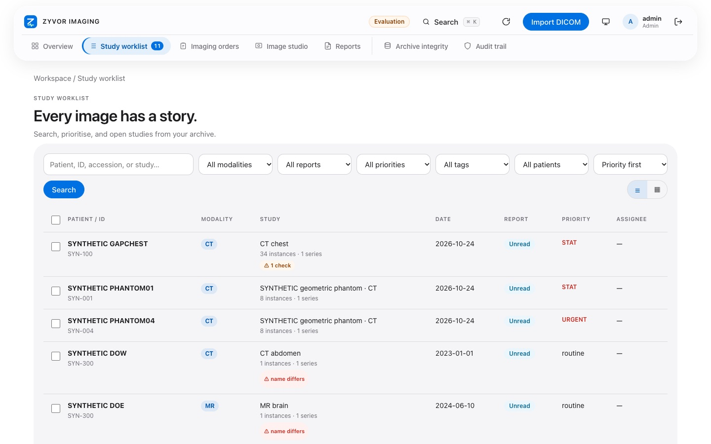

## Picture grid

Thumbnails for the whole worklist.

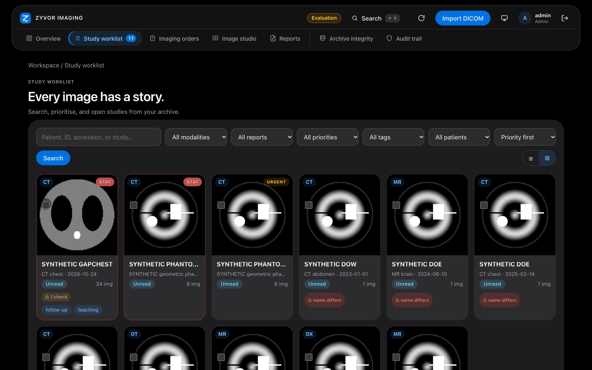

Light mode

## Imaging orders

Orders waiting and in progress.

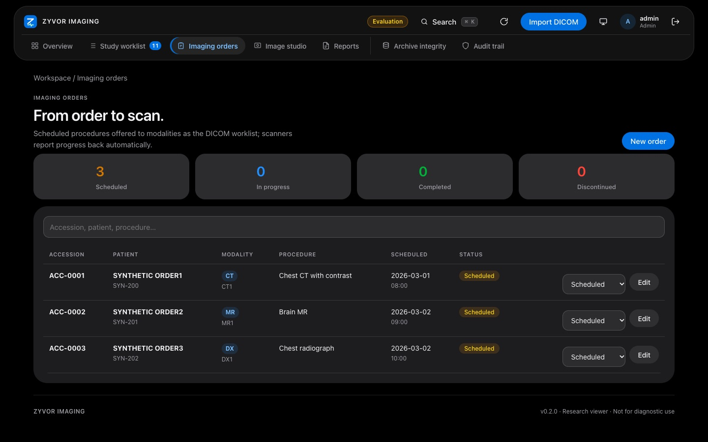

Light mode

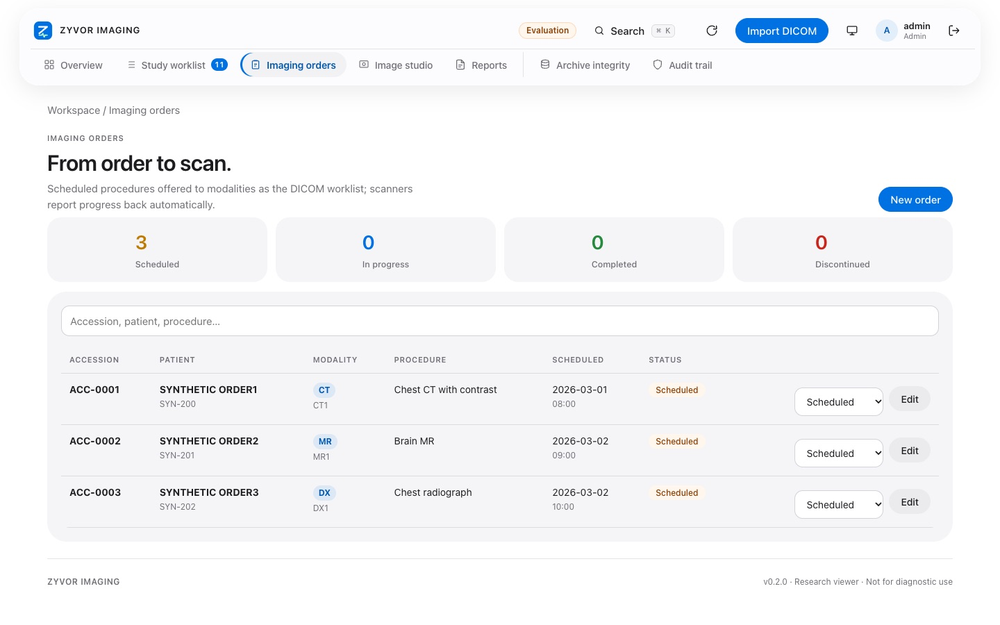

## Prior studies

Every earlier study of the same patient, one click away.

Light mode

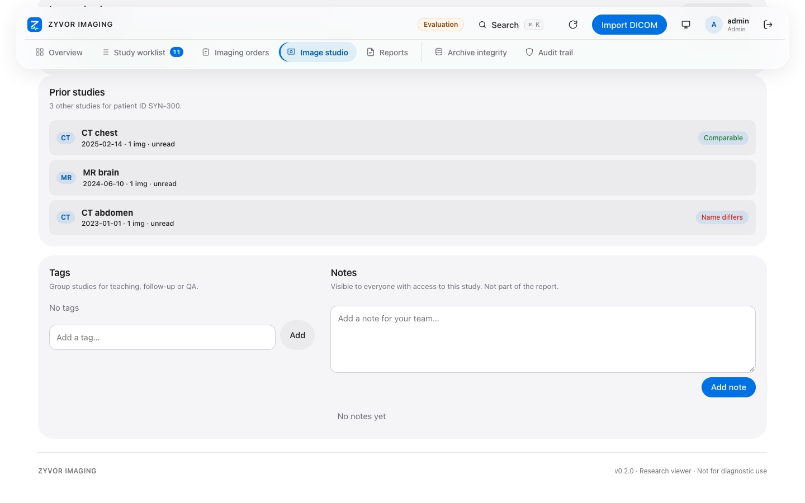

## Wrong-patient radar

A patient ID filed under two different names gets a warning above the images.

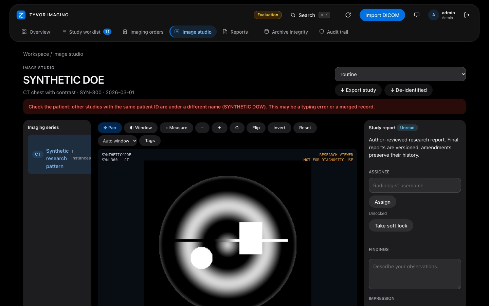

## Image checks

Plain-language technical checks for CT, MR and X-ray. Checks, not diagnoses.

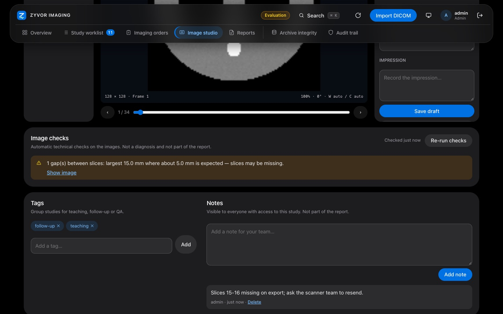

## De-identified export

Preview a pseudonymised copy before you download it. Not a certified de-identification.

Light mode

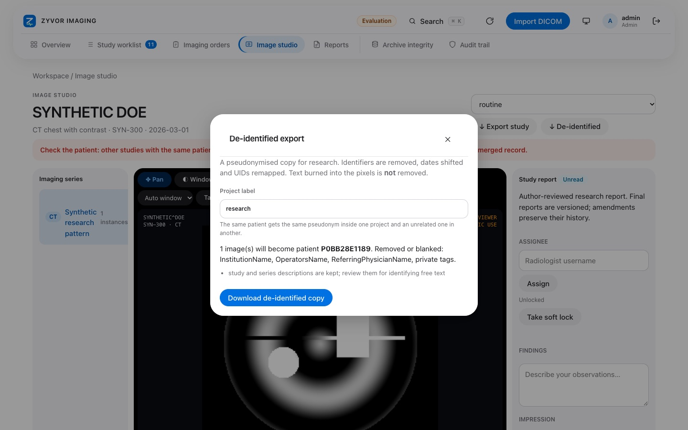

## Pick several

Tick a hand-picked group of studies to export together.

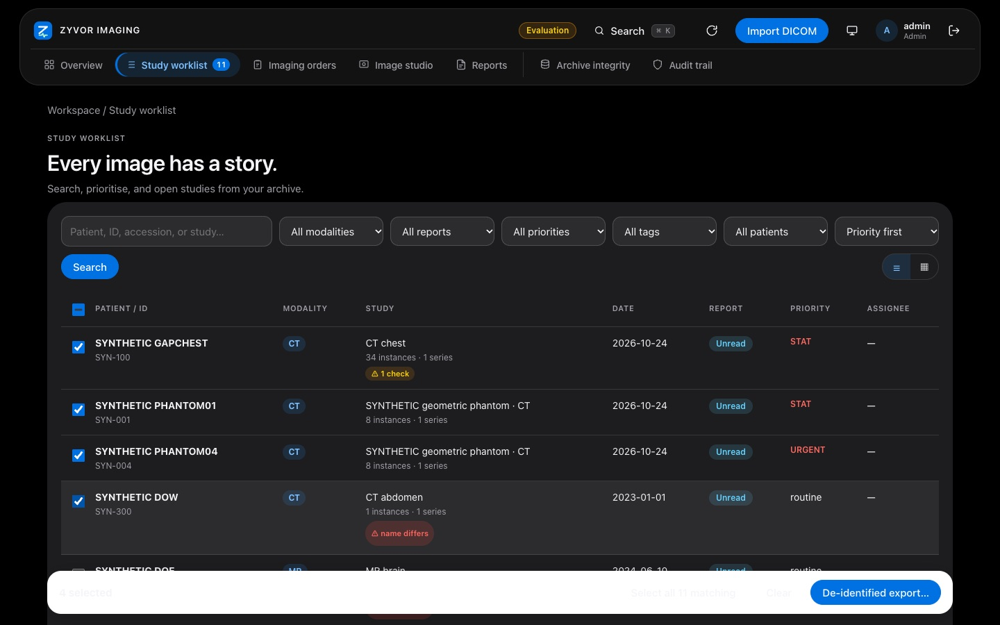

Light mode

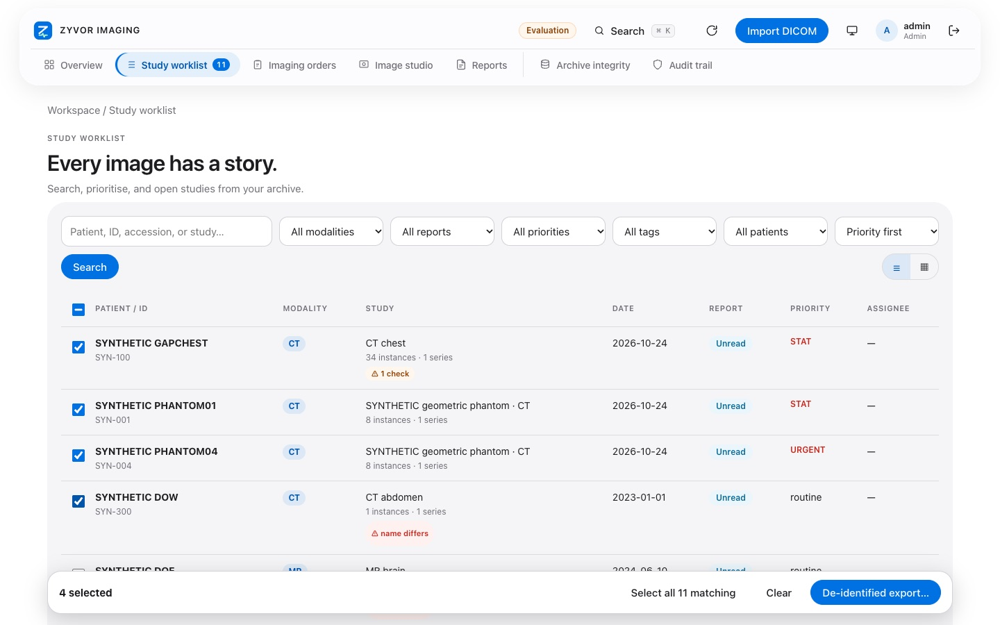

## Audit trail

Who did what, with an integrity check.

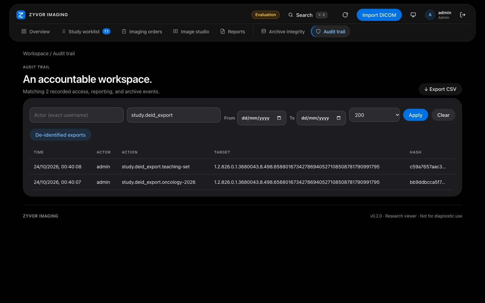

Light mode

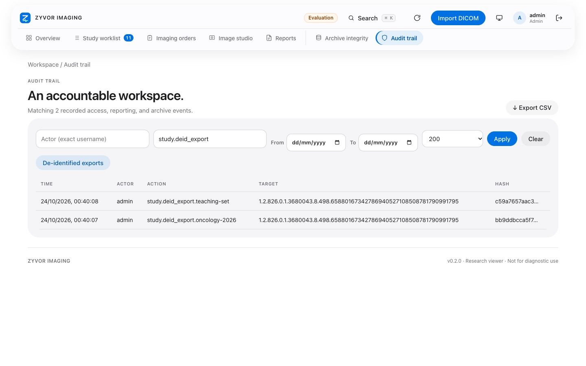

## Image studio

The research viewer: scroll, window/level, measure, tags.

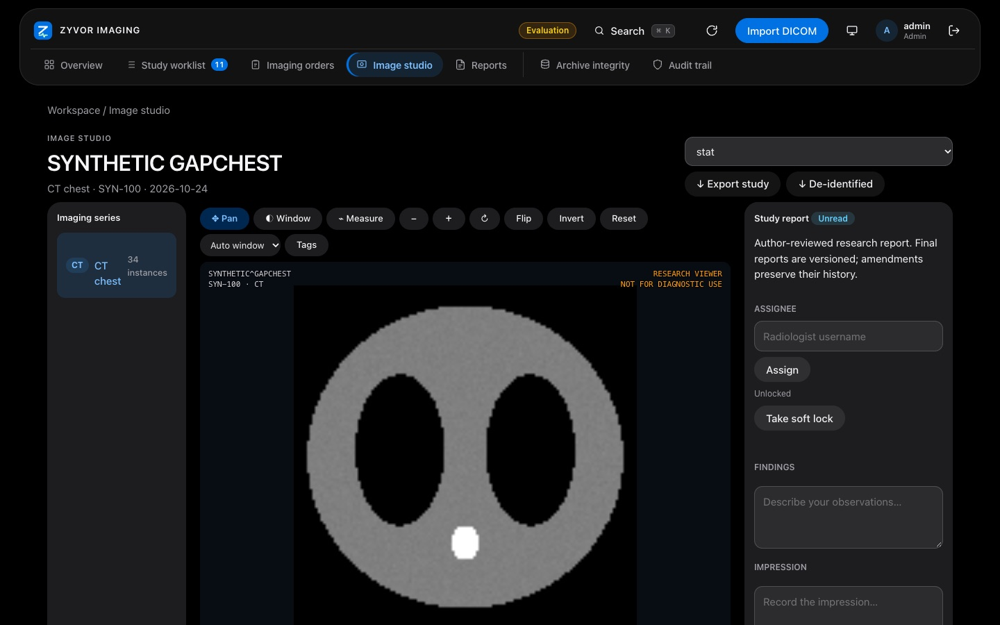

## A short tour

Back to the [documentation index](README.md).
