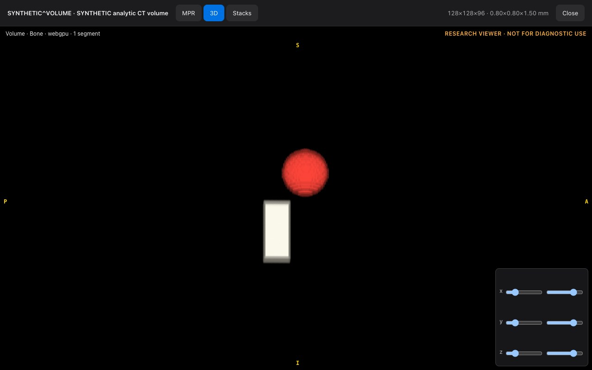

# The advanced research viewer

**Synthetic data only · Not for diagnostic use.**

This page describes the MPR / 3D viewer in Zyvor Imaging **0.4.0** and later. It is not in 0.3.2 or earlier. It is a **research viewer for evaluation**: it has not been validated for display, measurement or diagnosis, and nothing here is a claim that it is better than, or equal to, any other viewer.

## What it does

- **MPR.** Three linked planes (axial, coronal, sagittal) with a shared crosshair, thick-slab views, and the option to tilt all three planes together about the patient axes.
- **3D.** Volume rendering with bone, soft-tissue, lung and vessel presets, plus MIP, MinIP and average projections, a clip box, and your saved segments drawn in colour. It uses WebGPU where the browser has it and WebGL2 otherwise, and switches itself to MIP if volume rendering is too slow on your computer.
- **Stacks.** Several series of one study side by side (1×1, 1×2, 2×1 or 2×2), placed by a hanging protocol and scrolled together by position in the patient when the series belong together.
- **Measurements.** Length, angle, ellipse, rectangle and point probe with Hounsfield statistics. They can be selected, reshaped, moved and deleted, and are saved with the series.
- **Segments.** Start from a click (everything connected, or everything in a value range), then refine with a brush, an eraser, fill holes and smoothing, with undo. Volume and Hounsfield statistics are listed. Segments are saved with the series and rebuilt from the pixels each time.
- **DICOM output.** Download or store a DICOM Segmentation object and a DICOM Structured Report of the measurements and segments. Segmentation objects made elsewhere (binary or 8-bit fractional) can be stored and are drawn over the images.
- **Our own decoders.** Images in common compressed formats (JPEG, JPEG-LS, JPEG 2000 and High-Throughput JPEG 2000) are decoded in the browser by code written for this product.

## Five things to try

1. **Open the phantom.** Worklist, search `SYN-VOL`, open the study, press **MPR / 3D**.
2. **Find the sphere.** Click the bright ball in the axial view; the other two planes follow the crosshair.
3. **Tilt the planes.** Type `30` into the Tilt boxes, then press **Reset**.
4. **Grow a segment.** Press `g` and click the ball; then `x` to erase, `h` to fill holes, `z` to undo.
5. **Go 3D.** Open the **3D** tab, drag to rotate, press `1` to `4` for presets and move the clip sliders.

## How it was checked

All checking used **synthetic** images.

- A made-up phantom with known shapes, densities and spacing is the ground truth. Planes, tilted planes, measurements, segment volumes and 3D pictures are compared with values worked out from the phantom's geometry, and the two graphics back ends are compared with a slow reference renderer.
- Compressed-image decoders were compared with images from independent encoders, and fed damaged files.
- The scanner gateway was exercised with the command-line tools of DCMTK, an independent open-source toolkit: echo, store, find, get and move.
- A DICOM validator written by someone else was run over the Segmentation and Report files.

## What is not shown

- **No clinical validation** and no regulatory claim of any kind.
- **No comparison with other viewers** has been made, for speed or anything else.
- **No third-party viewer has opened our Segmentation or Report files**, so conformance with the DICOM standard is not claimed.
- Only **synthetic** studies were used; no real scanner series with several acquisitions.
- Speed figures come from one laptop and one graphics chip.
- Measurements are only available on the standard planes, not on tilted ones.
- Hanging protocols are fixed; you cannot yet edit or save your own.

If you want to look at it, ask for a demo and tell us what you would like to see: [sales@zyvor.dev](mailto:sales@zyvor.dev?subject=Zyvor%20Imaging%20advanced%20viewer%20demo). See also [Intended use and limits](INTENDED-USE.md).
