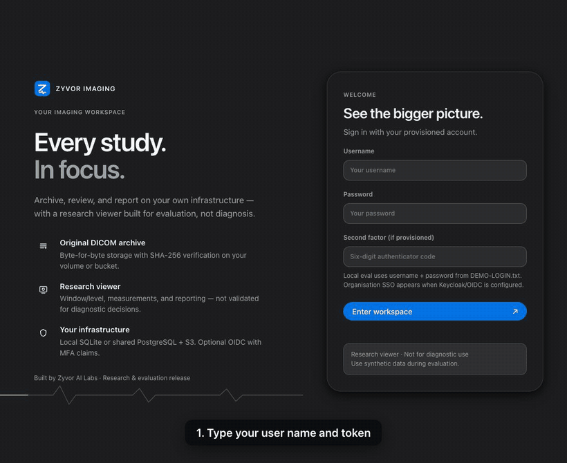
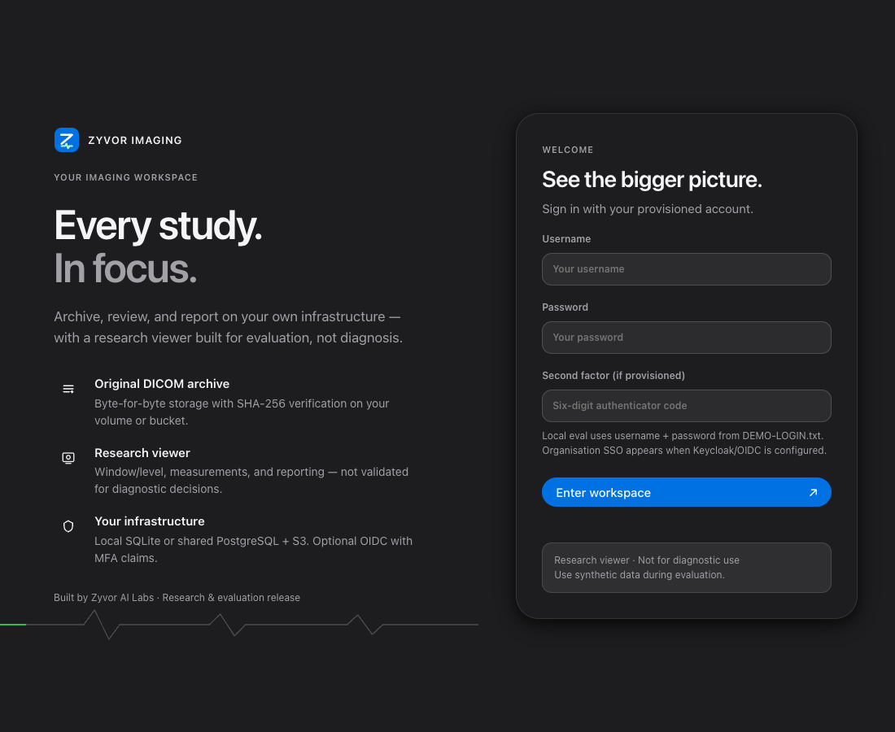

# 1. Install and open your first study

**Engineering release · Synthetic data only · Not for diagnostic use.** About 10 minutes.

You will start the real application on your own computer with made-up studies, sign in, and open a study.

## Option A: one command with Docker (Mac, Windows, Linux)

1. Install [Docker Desktop](https://www.docker.com/products/docker-desktop/), start it, and wait until it says it is running.
2. Make a password of at least 32 characters. Any long random string works; for example, in a terminal: `python3 -c "import secrets; print(secrets.token_hex(20))"` prints 40 characters.
3. Start the application (the image is public, so there is no login to a registry). Replace `PASSWORD` with the string from step 2 in both places you see it:

   ```bash
   docker run --rm -p 8080:8080 \
     -e IMAGING_SEED_DEMO=true -e IMAGING_SECURE_COOKIE=false \
     -e IMAGING_USERS='{"admin":{"token":"PASSWORD","role":"admin"}}' \
     ghcr.io/zyvorai/zyvor-imaging:0.4.1
   ```

   On Windows PowerShell, put the three settings in a file called `demo.env` (one `NAME=value` per line, `IMAGING_USERS` on one line) and use `--env-file demo.env` instead of the `-e` options.
4. Wait about a minute. The first start pulls the image and adds the made-up studies. You are ready when <http://127.0.0.1:8080/health/ready> shows `{"status":"ready"}`.

The [live demo section of the website](https://zyvorai.github.io/zyvor-imaging-site/#live) writes this command and a fresh password for you in your browser; nothing is sent anywhere.

Stop it later with Ctrl+C. Everything is thrown away, because this demo keeps its data only inside the container.

## Option B: the Mac app

Download `Zyvor-Imaging-<version>.dmg` from the [latest release](https://github.com/zyvorai/zyvor-imaging-site/releases/latest), drag the app into Applications, open it, and enter the web address and login from the email you were sent. The DMG is signed and notarized.

## Sign in and open a study



1. Open <http://127.0.0.1:8080>. Type `admin` and your password, then press **Enter workspace**.

   
2. You land on the **Overview**: study counts, and tiles for what needs attention. With the demo data you should see **7** studies.
3. Open **Study worklist**. Type `SYN-VOL` in the search box and press **Search**. One study appears: the synthetic 3D phantom.
4. Click it. The image appears. Scroll with the mouse wheel to move through the images; drag to change brightness (window and level).

## What you should see

- Seven studies in the worklist, and `RESEARCH VIEWER · NOT FOR DIAGNOSTIC USE` on every image.
- The phantom has 96 images; the frame counter reads `n / 96`.
- No errors, and the page works with the wheel and the keyboard.

## If something is wrong

| Problem | Fix |
|---|---|
| `docker: command not found`, or "daemon not running" | Start Docker Desktop and wait until it says it is running. |
| The container exits at once, mentioning the token | The password was shorter than 32 characters. Make a longer one. |
| Port 8080 is already in use | Change `-p 8080:8080` to `-p 8081:8080` and open port 8081. |
| Zero studies | Wait another minute; the studies are added a few at a time. |
| A Mac with Apple silicon is slow | The image has a native arm64 build. Pull again to be sure you do not get an emulated one. |

Next: [the research viewer in 10 minutes](02-research-viewer.md).
