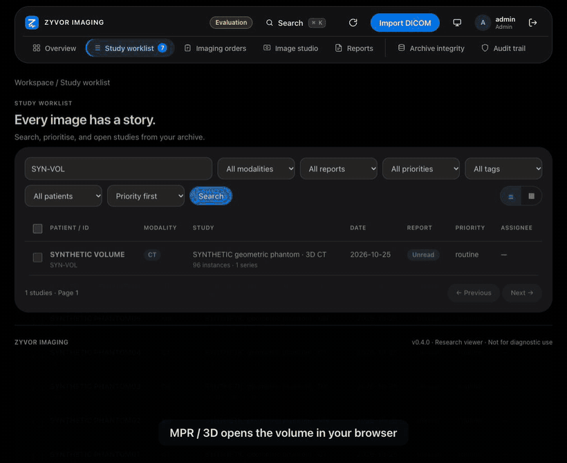

# 2. The research viewer in 10 minutes

**Engineering release · Synthetic data only · Not for diagnostic use.** You need version 0.4.0 and the phantom study from [tutorial 1](01-install-and-first-study.md).

## Open the viewer

1. Open the `SYN-VOL` study as in tutorial 1.
2. Press **MPR / 3D** in the toolbar. The status line reads `128×128×96 · 0.80×0.80×1.50 mm`: the volume was built from the study's own geometry.
3. Three planes appear (axial, coronal, sagittal) with a shared crosshair. The bright ball is a sphere in the phantom; the grey ellipse is soft tissue.

## Look around

- **Wheel** over a plane moves that plane. **Click or drag** moves the crosshair, and all three planes follow.
- **Shift-drag** changes window and level. Keys `1` to `6` pick presets.
- `[` and `]` change the slab thickness, `m` changes how a slab is combined, and `r` resets the view.

## Measure a value

1. Press `p` (probe), click the grey tissue, then click the middle of the bright ball.
2. Labels appear: **40 HU** in the tissue and **300 HU** in the ball. These are the phantom's known values, so you can see the numbers are right. Real scanners are noisier, so this check proves the arithmetic, not any clinical accuracy.
3. Other tools: `l` length, `a` angle, `e` ellipse, `b` rectangle, and `v` goes back to the crosshair. Backspace deletes the selected measurement. Lengths use the study's pixel spacing.

## Tilt the planes

Type `25` in the **x** box under **Tilt**, then `35` in **z**. All three planes turn together and each shows **TILTED**. Press **Reset** (or `r`) to go back.

## 3D

1. Press the **3D** tab. Drag to rotate, scroll to zoom. Keys `1` to `4` pick presets (bone, soft tissue, lung, vessels); `m` cycles volume, MIP, MinIP and average.
2. Open the **clip** sliders and move **x lo** upwards: the volume is cut open from one side. `c` resets the box.
3. On a computer without WebGPU the viewer uses WebGL2. If a full-quality frame is over its time budget it falls back to a MIP and says so.

## Stacks

Press **Stacks** to see the study's series side by side (keys `1` to `4` pick 1x1, 1x2, 2x1, 2x2). Scrolling is linked by position in the patient, so the same anatomy lines up. `l` turns linking off.

Press **Escape** to close the viewer.

## What you should see

- 40 HU and 300 HU at the two probe points.
- `TILTED` on all three planes after you tilt.
- A rendered 3D picture that changes when you drag the clip slider.

## If something is wrong

| Problem | Fix |
|---|---|
| The **MPR / 3D** button is greyed | The series has one image. Pick the phantom. |
| "geometry" error instead of planes | The series is missing positions or has uneven spacing; the viewer refuses rather than guess. |
| 3D is blank | Use a recent Chrome, Edge or Safari. Check the GPU is not blocked. |
| Keys do nothing | Click once inside a plane first; keys typed into a number box are not shortcuts. |

Full key list: [VIEWER.md](../VIEWER.md). Next: [segmenting](03-segmenting.md).
