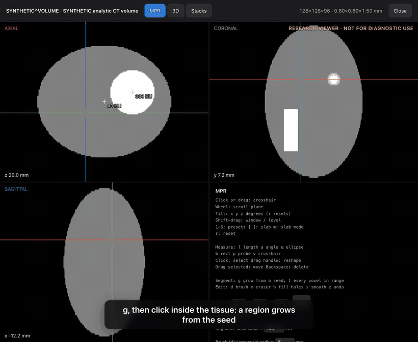

# 3. Segment, edit and export a DICOM SEG

**Engineering release · Synthetic data only · Not for diagnostic use.** You need the viewer open on the phantom ([tutorial 2](02-research-viewer.md)), signed in as `admin` or a `radiologist`. The `viewer` and `technologist` roles can look but not save.

## Grow a segment

1. In the MPR view click once inside a plane so the keyboard goes there.
2. Press `g`, then click in the grey tissue. A coloured region grows: every connected voxel within ±100 HU of the value you clicked. The side panel lists **Segment 1** with its volume and mean.
3. The note reads **Saved to the archive**. Only the definition (the seed, the range and your edits) is stored; the mask is recomputed from the image each time.
4. `t` instead of `g` selects every voxel in range, connected or not.

## Edit it

| Key | What it does |
|---|---|
| `x` | Eraser: click or drag to take a ball (default radius 5 mm) out of the segment |
| `d` | Brush: paint a ball in |
| `h` | Fill holes |
| `s` | Smooth |
| `z` | Undo the last edit (this session) |

Change the range (HU) and the brush radius in the **Segmentation** panel. Every edit appears in all three planes and in the 3D tab, where the segment is drawn in colour (`s` shows or hides it).

## Export

- **Download DICOM SEG** writes a standard DICOM Segmentation object (Binary). It becomes available once an edit has reached the archive.
- **Download DICOM SR** writes a Structured Report of your measurements.
- To keep a SEG in the archive, post it back (`POST /api/instances`). The study page then lists it under **Reports**, and the viewer draws it read-only.

You can check a file with any DICOM tool. For example, with pydicom: `python -c "import pydicom; d=pydicom.dcmread('segments.dcm'); print(d.Modality, d.NumberOfFrames)"` prints `SEG` and a frame count.

## What this does and does not claim

Segments here are for research and demonstration. Region growing and a brush are not a validated lesion-measurement method. Nothing here is a diagnostic result; see [LIMITATIONS.md](../INTENDED-USE.md).

## What you should see

- A coloured region after `g` plus a click, and **Saved to the archive**.
- A smaller region after `x`, and a restored one after `z`.
- A downloaded file of about 230 KB for the phantom, whose first bytes after 128 zeros read `DICM`.

## If something is wrong

| Problem | Fix |
|---|---|
| "Grow a segment first" | Press `g` and click again. Click once inside a plane first so keys reach it. |
| Nothing grows when you click | You clicked on a measurement (probe label). Click in clear tissue, or press Backspace on the selected measurement. |
| **Download DICOM SEG** is greyed | Nothing is saved yet, or you are signed in as a read-only role. |
| "Nothing in range at the seed" | Widen the HU range, or click a voxel that has tissue. |

Questions or something unclear? [sales@zyvor.dev](mailto:sales@zyvor.dev?subject=Zyvor%20Imaging%20evaluation%20feedback).
